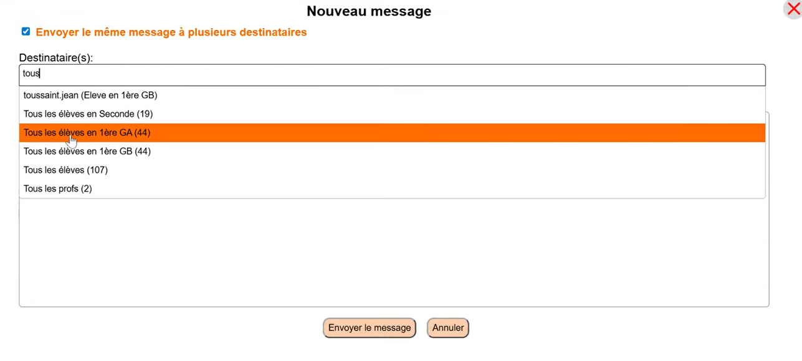

Dans ce tutoriel, nous allons voir comment envoyer un même message privé à plusieurs utilisateurs depuis l'interface Sekooly : des élèves d'une même classe, tous les profs, voire même tous les élèves.

## Étape 1 : Accéder à la messagerie

Tout en haut de la page, cliquez sur l'icône des **Messages privés** .

## Étape 2 : Sélectionner les destinataires

Cliquez sur le bouton **Nouveau message**.   
Cochez ou ajoutez la liste des destinataires concernés dans le champ prévu à cet effet. Vous pouvez chercher le terme **Tous** pour retrouver les groupes d'utilisateurs qui vous intéressent    
- Tous les **élèves** d'une **classe précise**
- Tous les **élèves** de **votre cycle**
- Tous les **profs** de **votre cycle**
   

## Étape 3 : Rédiger et envoyer le message

* Écrivez le corps du message.
* Validez l'opération en cliquant sur le bouton d'envoi.
Une notification en bas de page confirme l'envoi du message à l'ensemble des destinataires sélectionnés.

